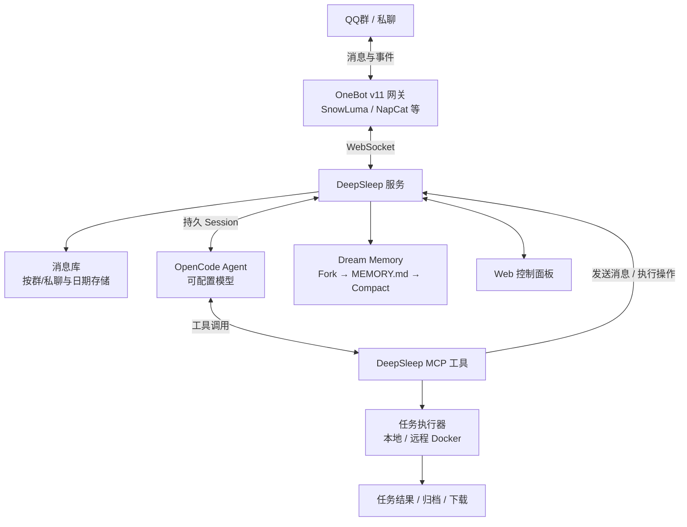

<div align="center">

# DeepSleep

### 不只是回答问题，而是成为群聊的一员。

**面向 QQ 群聊和私聊的持久化自主 AI Agent 框架。**

主动参与群聊、持续记忆、调用工具完成任务。让 AI 不只是被动回复消息，而是能够长期融入群聊的 Agent。

[](LICENSE)


[核心能力](#核心能力) · [工作原理](#工作原理) · [梦境记忆](#梦境记忆) · [快速开始](#快速开始) · [部署文档](docs/DEPLOY.md) · [参与贡献](CONTRIBUTING.md)

</div>

---

## DeepSleep 是什么？

大多数机器人只能等一条指令，再给出一条回答。**DeepSleep 让 AI 不只是等待指令，而是能够长期参与群聊。**

它会观察一段时间内的聊天内容，结合语境决定要不要接话；能够理解图片、发送表情、查找资料、设置提醒，或把更复杂的任务交给 Docker 沙箱执行。每个群聊和私聊都有独立的持久会话，夜间通过 **Dream Memory（梦境记忆）** 提炼值得保留的信息，减轻无限增长的上下文负担。

**DeepSleep 是框架，不是固定的机器人名字，也不是某个特定大模型。** 你可以为实例设置自己的名称与人设，通过 OpenCode 选择可用的模型提供商。QQ 只是它目前面向的交互场景。

> **一句话：能接话、能记事、能动手，也知道什么时候保持安静。**

## 核心能力

| 能力 | 能做什么 |
| :-- | :-- |
| **自主参与群聊** | 按窗口汇总群聊上下文，自主选择接话或保持沉默；被 @ 或回复时及时处理，不是每条消息都强行插嘴。 |
| **梦境记忆** | Fork 会话整理聊天经历，更新 `MEMORY.md`，再 Compact 原会话；保留长期有用的事实、关系与待办。 |
| **持久会话** | 每个群/私聊独立维护 OpenCode Session；重启后可继续使用已有会话，不必每次从零认识群友。 |
| **多模态与自然表达** | 理解图片和表情原图、发送 QQ 小黄脸/收藏表情、引用回复与戳一戳；支持可选的语音合成与语音识别。 |
| **任务执行** | 使用 MCP 搜索、查询聊天记录、设置提醒；复杂任务提交到本地或远程 Docker 沙箱运行，并回传结果。 |
| **配置与管理** | Web 控制面板、机器人主人权限、可切换的模型、消息数据库，以及独立的 OneBot v11 接入层。 |

### 它在群里是什么样的？

下面展示的是**交互行为示意**，并非实际运行截图：

```text
群友 A：有人知道这是什么图吗？ [图片]
DeepSleep：让我看看……

群友 B：@DeepSleep 帮我查下这个项目最近更新了什么
DeepSleep：我去找找，等下给你说重点。

群里聊了一阵，没人 @ 它……
DeepSleep：这话题我可有点想说两句。

凌晨，群聊安静下来……
DeepSleep：〔内部整理长期记忆，不向群里刷屏〕
```

模型是否主动发言、调用哪些工具、具体表达方式，都取决于配置、上下文和实际模型表现。

## 工作原理



DeepSleep 将消息接入、Agent 推理和工具执行分离：

- **OneBot 网关**负责与 QQ 收发消息；DeepSleep 本身不实现 QQ 协议，也不捆绑网关。
- **DeepSleep 服务**负责上下文组织、Session 管理、消息持久化、权限、工具和调度。
- **OpenCode Agent**负责推理和选择行动。模型通过明确的 MCP 工具发消息；**没有调用发送工具就不会由系统擅自代发回复**。
- **任务沙箱**负责跑命令、读写文件等重活，与普通群聊的主 Agent 隔离。完整执行层见 [qqbot-hk-runner](https://github.com/123321-QSTUDIO/qqbot-hk-runner)。

### 群聊上下文与自主回应

默认开启**群聊批量上下文**：新消息进入窗口后，系统最长约 **10 分钟**汇总一次；若群里提前安静下来，默认在最后一条消息后约 **60 秒**投喂。被 @ 或收到针对机器人的引用回复时，会要求尽快刷新当前窗口，并在相关消息上标注 `[须回应]`。

普通聊天不是每条消息都强制回复：模型可以接话，也可以选择 `[SILENT]`。私聊与戳一戳有各自的即时处理路径；引用回复能够带上被引用消息的内容，避免只见「回复了谁」却不知道「回复了什么」。

### 工具调用与任务执行

内置 MCP 工具涵盖消息、表情、戳一戳、聊天记录查询、联网搜索兜底、定时提醒和任务提交等场景。日常小问题可由主 Agent 直接处理；需要执行命令、探索代码或产出文件的任务，可交给配置好的 Docker 执行环境。

任务可以使用本地或远程 Docker；远程执行层按用户维护可休眠工作环境和有限期归档。任务完成后，群里获得简短结论，详细结果按现有权限与配置通过私聊或下载链接提供。

## 梦境记忆

**聊天记录不等于长期记忆，上下文也不应该无限增长。**

DeepSleep 为每个会话维护人类可读的 `MEMORY.md`，记录值得长期保留的群聊信息。每天夜间在默认 **02:00–05:00** 的时间窗内，为不同会话安排整理；通常等待群聊至少 **30 分钟**没有新消息，到窗口结束时则按调度策略执行。

```text
原 Session 持续聊天
      │
      ├─ Fork 临时「梦境会话」
      │      ├─ 读取旧 MEMORY.md 与已有上下文
      │      └─ 写入 MEMORY.new.md
      │
      ├─ 校验内容、备份旧文件、原子替换 MEMORY.md
      ├─ 删除临时会话
      └─ Compact 原 Session，让新记忆进入后续上下文

梦境整理期间：新消息先入库 → 整理结束再恢复投喂
```

这套机制**不训练、不修改模型权重**，而是在 Agent 层整理、更新外部记忆。长期记忆可能遗漏或概括错误，可在控制面板查看、修订。详细行为、失败处理和手动触发方式见 [部署文档](docs/DEPLOY.md#82-梦境记忆默认已开启)。

## 快速开始

> 以下为**独立服务模式的最小启动路径**。需要预先准备能正常运行的 OneBot v11 QQ 网关，并安装 OpenCode。仅使用聊天能力不必先搭建远程 Docker；复杂任务功能需要另行配置执行环境。

### 运行要求

- **Node.js 22 LTS（推荐；代码目标环境为 Node.js 18+）**、npm、Git。
- **OpenCode 2.1.4**，在本机以 `serve` 模式运行。
- 提供 **OneBot v11 WebSocket** 的 QQ 网关，如 [SnowLuma](https://github.com/SnowLuma/SnowLuma) 或兼容实现。
- 若启用复杂任务，还需要本地或远程 Docker 环境。

### 1. 获取并构建

```bash
git clone https://github.com/123321-QSTUDIO/deepsleep.git
cd deepsleep
npm ci
npm run typecheck
npm run build
```

构建产物位于 `dist-service/`，服务入口为 `dist-service/index.mjs`。

### 2. 启动 OpenCode

```bash
npm install -g @opencode/cli@2.1.4

# Linux / macOS Shell 示例：请换成自己的强密码
export OPENCODE_PASSWORD="CHANGE_ME_STRONG_PASSWORD"
opencode serve --hostname 127.0.0.1 --port 4096
```

Windows PowerShell 可将环境变量设置为 `$env:OPENCODE_PASSWORD = 'CHANGE_ME_STRONG_PASSWORD'`，然后运行同一条 `opencode serve` 命令。

> **重要：** 必须让 DeepSleep 配置里的 `opencodePassword` 与 `OPENCODE_PASSWORD` 一致。OpenCode 的模型可用性、授权和费用由所选 Provider 决定，默认模型 ID 也可能随服务变化。

### 3. 生成并修改配置

在**另一个终端**启动一次服务以生成默认配置，随后停止进程（此时网关或 OpenCode 未就绪可能显示连接错误，属正常现象）：

```bash
node dist-service/index.mjs
```

编辑项目目录下自动生成的 `data/config.json`，至少确认以下字段：

```json
{
  "botName": "DeepSleep",
  "botNameEn": "",
  "ownerQqs": "",
  "onebotUrl": "ws://127.0.0.1:3001",
  "onebotToken": "YOUR_ONEBOT_TOKEN",
  "opencodeUrl": "http://127.0.0.1:4096",
  "opencodePassword": "CHANGE_ME_STRONG_PASSWORD",
  "mcpToken": "YOUR_MCP_TOKEN",
  "panelToken": "YOUR_PANEL_TOKEN"
}
```

上面是**配置片段**，不要直接拿它覆盖自动生成的整个文件；其余字段由默认配置提供。`ownerQqs` 填机器人主人的 QQ 号（可用逗号分隔），用于限制 `/reset`、`/abort` 等管理操作；群主/群管理员与机器人主人是不同身份。

MCP 服务使用 `mcpToken` 鉴权；框架会为 Agent 工作区生成对应连接配置。**不要把密码、QQ 号或 Token 提交到 Git。**

### 4. 连接 QQ 并运行

先按你的网关文档启动 QQ 接入服务，确保 OneBot WebSocket 地址和鉴权配置与 `data/config.json` 一致，然后重新启动：

```bash
node dist-service/index.mjs
```

默认控制面板位于 **http://127.0.0.1:5101/**（仅监听本机）。配置好机器人 QQ 账号、连接与模型后，就可以在群里 @ 它进行测试。

**Windows Server 常驻部署、网关配置、SSH 隧道、Docker 执行层以及故障排查**，请直接阅读 [完整部署手册](docs/DEPLOY.md)。

## 常用配置

| 字段 | 用途 | 默认值 |
| :-- | :-- | :-- |
| `botName` / `botNameEn` | 机器人的主要名称 / 可选英文或次名称，均独立于框架名 | `DeepSleep` / 空 |
| `ownerQqs` | 机器人主人 QQ 列表，控制管理命令权限 | 空 |
| `hostModel` | 主 Agent 默认模型 | `opencode/deepseek-v4.1-flash-free` |
| `visionModel` | 主模型不支持图片时使用的识图子代理模型 | `opencode/mimo-v2.6-flash-free` |
| `groupContextBatchEnabled` | 是否启用群聊批量上下文模式 | `true` |
| `groupContextBatchIntervalSec` | 每个群的最大批量窗口时间 | `600` |
| `groupContextBatchIdleFlushSec` | 群聊冷场后提前投喂的等待时间 | `60` |
| `dreamMemoryEnabled` | 是否启用梦境记忆 | `true` |
| `dreamMemoryIdleMinutes` | 梦境整理前的默认群聊空闲时间 | `30` |
| `panelHost` / `panelPort` | WebUI 监听地址及端口 | `127.0.0.1` / `5101` |
| `ttsEnabled` | 是否启用可选 TTS 语音功能 | `false` |

更完整的配置说明、远程执行、下载链接与存储配额见 [部署文档](docs/DEPLOY.md)。模型可通过面板管理；不同 Provider 的可用性、上下文长度和费用可能不同。

## Web 控制面板

不想每次都改 JSON？DeepSleep 内置一个与服务同进程的本地 WebUI，可查看和管理：

- 配置与模型、群聊/私聊 Session 及运行状态；
- OpenCode 对话、QQ 消息记录、工作区文件、长期记忆与梦境状态；
- 收藏表情包的同步、分类、标签与启用情况；
- 会话重置、中断、人工发送消息、手动投喂与梦境整理。

远程访问推荐使用 **SSH 端口转发**，不要直接把面板或 MCP 端口暴露到公网。启用反向代理等远程访问方式时，务必配置 `panelToken` 与适当的访问控制。

## 开发与项目结构

```bash
npm ci
npm run typecheck
npm run build
```

公开仓库提供构建所需的项目源码；维护者的内部冒烟测试与验收报告不随公开版本分发。提交改动前至少通过类型检查和构建；涉及 Session、MCP、消息路由等功能的修改，建议额外搭建测试环境进行验证。AI Agent 或开发者接手项目时，可以先阅读 [AGENTS.md](AGENTS.md) 的架构说明与修改约束。

| 路径 | 职责 |
| :-- | :-- |
| `src/app.ts` / `src/main.ts` | 服务组装与独立运行入口 |
| `src/sessions.ts` / `src/opencode.ts` | Session、Prompt、OpenCode 接入与事件处理 |
| `src/agentsmd.ts` | 机器人身份、人格和工具提示词生成 |
| `src/mcp.ts` | MCP 工具与权限边界 |
| `src/dream.ts` / `src/msgdb.ts` | 梦境记忆与聊天记录存储 |
| `src/panel.ts` / `src/panel.html` | Web 控制面板 |
| `src/executor.ts` / `src/tasks.ts` | Docker 任务执行与状态管理 |
| `docs/DEPLOY.md` | Windows Server 部署、远程执行层和运维说明 |

## 参与贡献

欢迎提交 Issue、Bug 报告和 Pull Request！建议先看 [CONTRIBUTING.md](CONTRIBUTING.md) 了解开发环境、构建要求与提交规范；安全问题请通过 [SECURITY.md](SECURITY.md) 提供的私密渠道报告。

**项目曾用名：** `napcat-plugin-qqbot`。当前为独立服务架构，旧的 NapCat 进程内插件形态已停止维护。

## 安全与使用说明

- **非腾讯官方项目。** DeepSleep 与腾讯、QQ、OpenCode、SnowLuma 及模型提供商均无官方隶属关系。请遵守所在平台的规则以及适用法律；使用非官方网关可能有账号或兼容性风险。
- **不内置 QQ 协议实现。** OneBot 网关需自行选择、安装和维护，第三方网关的授权条款独立适用；本仓库不打包 SnowLuma。
- **数据由部署者管理。** 会话、聊天日志、工作区和 `MEMORY.md` 会保存在本地或自选服务器；请妥善保护账号凭据、群成员隐私、下载链接与备份文件，并建立合适的清理策略。
- **先隔离，再给权限。** Docker 沙箱、MCP、OpenCode 工具执行和面板都可能操作文件或访问外部服务。建议最小权限运行，不要把 Docker API、面板或未加密的鉴权 Token 暴露到公网。
- **功能不等于无限制承诺。** 主动聊天、图片理解和工具执行的效果取决于网关、模型、服务商及部署配置。

## 许可证

DeepSleep 使用 **[Apache License 2.0](LICENSE)** 开源，Copyright © 2026 123321-QSTUDIO。

分发时请保留适用的版权和许可证声明，并遵守仓库中的 [NOTICE](NOTICE) 文件。

---

<div align="center">

**DeepSleep — 不止于问答的群聊 Agent。**

*Talk naturally. Remember what matters. Get things done.*

</div>
